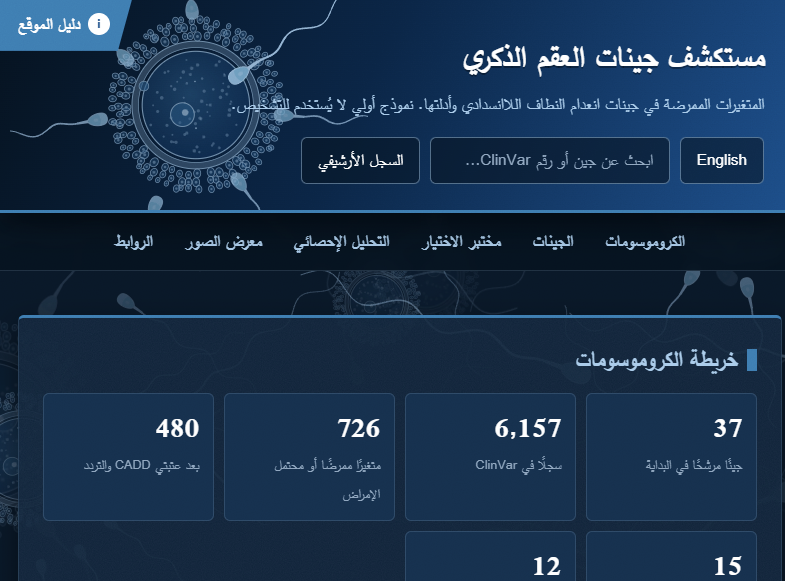

# Investigation of Genes Causing Male Infertility Using Bioinformatics Techniques

Graduation project, B.Sc. Biomedical Sciences, Damascus University.
Author: Ali Saleh.

A retrospective in silico study of 16 validated male-infertility genes. It re-evaluates ClinVar pathogenic variants by matching each submission to the disease it was registered for, and integrates 13 layers of evidence into a traceable variant-level matrix. The work was carried out along three tracks (a Galaxy/VEP platform track, a Python/Colab programmatic track, and an AI-assisted track) and compared with paired statistics.


## Project materials

| Material | Where |
|---|---|
| Full thesis (PDF) | [`thesis2/PROJECT_FINAL.pdf`](thesis2/PROJECT_FINAL.pdf) |
| Interactive website (source) | [`website2/`](website2/) |
| Website (GitHub Pages, after enabling) | https://alisalehhh-rgb.github.io/male-infertility-project-bioinformatics/ |
| Google Drive archive (24 folders) | [`docs2/google-drive-links.md`](docs2/google-drive-links.md) |
| GitHub web-upload guide | [`docs2/PUBLISHING.md`](docs2/PUBLISHING.md) |
| Figures (51) | [`results2/figures/`](results2/figures/) |
| Tables (58 CSV) | [`results2/tables/`](results2/tables/) |
| Strengths & novelty report (English, PDF) | [`docs2/strengths_and_novelty_report_en.pdf`](docs2/strengths_and_novelty_report_en.pdf) |
| Strengths & novelty report (English, DOCX) | [`docs2/strengths_and_novelty_report_en.docx`](docs2/strengths_and_novelty_report_en.docx) |

## Why it matters
- The genetic cause remains unknown in most men with infertility, and in non-obstructive azoospermia in particular.
- Public databases such as ClinVar list many "pathogenic" variants, but a variant labelled pathogenic may be registered for a different disease. A gene can be strongly linked to male infertility while most of its pathogenic variants belong to other conditions (for example AR, whose registrations are mostly androgen insensitivity and Kennedy disease).
- Matching each variant to its registered disease turns a long list of "pathogenic" variants into a disease-matched candidate list ready for functional validation.

## Detailed description

**Aim.** To test whether variants classified as pathogenic in genes with validated links to male infertility are registered for male infertility, and to build a reproducible, traceable evidence table of candidate variants for functional follow-up. The study re-examines variants already submitted to public databases and interprets them within the male-infertility context, as an interpretive layer that complements molecular diagnosis.

**Design.**
1. Gene selection: 37 candidate genes from the Male Fertility Gene Atlas; 16 retained with at least moderate gene-disease validity (Houston 2022; Zhao 2025).
2. Variant extraction: 6,157 ClinVar variants in candidate genes -> 726 pathogenic/likely pathogenic -> 712 in the 16 genes.
3. Disease matching at the level of each ClinVar submission (SCV): was the variant registered for male infertility or for another disease?
4. Annotation and filtering: Ensembl VEP, CADD >= 20, gnomAD v4 frequency <= 0.001, MANE Select transcripts.
5. Evidence layers: GTEx v8 and Human Protein Atlas expression, splice and missense predictors, NMD prediction, AlphaFold-based structural views (ChimeraX, PyMOL).
6. Prioritisation: 15 representative variants in 16 genes (8 stop-gain, 5 splice, 2 missense; CADD 27.2 to 46), with all groups and rules defined before looking at results and nine threshold scenarios tested.

**Output.** A disease-matched candidate list ready for functional validation, supported by a traceable, multi-layer evidence matrix.

## Pipeline (stages)
| Stage | Content | Script |
|---|---|---|
| S01 | Male Fertility Gene Atlas (MFGA) candidate genes | `src2/02_s01_mfga.py` |
| S01B | Gene-disease validity (moderate or higher evidence) | `src2/03_*`, `src2/04_*` |
| S02 / S02B | ClinVar pathogenic / likely pathogenic extraction and phenotype stratification (submission level) | `src2/05_*`, `src2/06_*`, `src2/07_*` |
| S04 | Ensembl VEP + gnomAD v4 (consequence, allele frequency) | `src2/08_*`, `src2/09_*` |
| S06 | GTEx v8 tissue expression | `src2/10_*` |
| S07 | Human Protein Atlas (RNA and immunostaining) | `src2/11_*` to `src2/13_*` |
| S05 | Prioritisation (CADD, frequency, disease matching, MANE consequence fix) | `src2/14_*` |
| Checks | Manifest and comparison with earlier results | `src2/15_*`, `src2/16_*` |

The full run is also available as one notebook: `notebooks/Final_Organized_A_full_rerun.ipynb` (Google Colab). The scripts in `src2/` are the notebook's code cells, extracted unchanged.

## Three execution tracks, compared
1. **Platform track** (`track1_galaxy_vep2/`): ClinVar on Galaxy, Ensembl VEP, and an Excel evidence matrix built with traceable formulas.
2. **Programmatic track** (`src2/`, `notebooks/`): the same pipeline in Python on Google Colab. Core values matched track 1 exactly (469/469 CADD scores and 131/131 allele frequencies).
3. **AI-assisted track** (`track3_ai_tools2/`): six AI tools/models received the same plan and were compared with a documented reference: Claude (Opus 5.5), Devin and Gemini 3 Pro with a single command; ChatGPT Plus and OpenCode (DeepSeek-V4-Flash) stage by stage; GPT-6 Astra, ChatGPT Plus and OpenCode on a verification task of 14 variants.

## Key results
- **177 of 712 (24.9%)** pathogenic variants are registered for male infertility.
- Disease matching changed **6 of 15** representative variants; moving the CADD threshold from 15 to 25 left all 15 unchanged across nine threshold scenarios.
- Final set: **15 representative variants in 16 genes**, all reproduced by the unified analysis.
- Reading raw files rather than summaries exposed errors made from memory and led to documented corrections (for example a GTEx value for MSH5 corrected from 3.10 to 34.60).
- Missense variants were analysed in detail in two versions (highest CADD, and CADD with disease matching) and visualised over AlphaFold models with ChimeraX and PyMOL.
- NMD was predicted for all eight stop-gain representatives.
- AI tools were compared with Cochran's Q, exact McNemar with Holm correction, Wilson intervals, Jaccard and a gene-clustered bootstrap (3,000 resamples); SHA-256 fingerprints audited the independence of each tool's outputs.
- A six-step protocol for comparing AI tools on genomic variant-prioritisation tasks was proposed.

## What makes the work strong
- **Submission-level disease matching:** each ClinVar submission (SCV) is read for the disease it was registered for, so gene-level strength is separated from variant-level evidence.
- **Pre-defined rules and sensitivity testing:** groups H (highest CADD), C (highest CADD among disease-matched) and M (strongest missense per gene) were defined before results; nine CADD/gnomAD scenarios gave the same 15 representatives.
- **Traceability and reproducibility:** a formula-driven Excel matrix (INDEX/MATCH across 48 sheets), SHA-256 fingerprints, a rerunnable Colab notebook, read-only inputs and corrections saved in new folders.
- **Thirteen integrated evidence layers:** ClinVar (SCV), CADD v1.7, gnomAD v4.1.1, SpliceAI, REVEL, AlphaMissense, LOFTEE, NMD, 1000 Genomes, OMIM, GTEx v8, HPA, AlphaFold/UniProt.
- **Detailed missense and structural analysis** with reproducible command files and pLDDT confidence values.
- **Three tracks compared with paired statistics** and a documented reference.
- **Website prototype:** an offline, bilingual (Arabic/English) evidence database with a "selection lab" that re-applies the rule when thresholds change, and an in-browser statistics engine (Cochran's Q, McNemar, Holm, Bonferroni, Wilson, Jaccard, bootstrap).
- **Mathematics and programming:** the Python pipeline, rule logic, formula-driven matrix, paired statistics and the JavaScript statistics engine all rest on mathematical and programming foundations.
- **Scale:** six chapters, 34 tables, 44 figures, more than 130 references, a 48-sheet Excel matrix and a log of 502 verified files.


## Website

The bilingual (Arabic/English), offline prototype is in [`website2/`](website2/). It runs by opening `website2/index.html` directly in any modern browser, without a server or internet connection (external database links aside).

A live GitHub Pages deployment will be available at (after enabling Pages):

**https://alisalehhh-rgb.github.io/male-infertility-project-bioinformatics/**

The site is deployed automatically from `website2/` by [`.github/workflows/pages.yml`](.github/workflows/pages.yml). To enable it: **Settings → Pages → Build and deployment → Source: GitHub Actions**.



## How to reproduce (Google Colab)
1. Create a Drive folder named exactly `Final - Google Colab` (the notebook looks for this name).
2. Open `notebooks/Final_Organized_A_full_rerun.ipynb` in Colab and run the first cell to mount Drive.
3. Set `FRESH_DOWNLOADS = True` in the setup cell to download all raw files again from the official sources (see `data2/README.md`).
4. Run the cells in order. Outputs go to stage folders (S01_MFGA, S02_ClinVar, ...).


## Google Drive archive

The full execution archive — per-tool prompts, code, logs, intermediate files, final outputs, verification runs, Galaxy history and Colab workspaces — is indexed in [`docs2/google-drive-links.md`](docs2/google-drive-links.md). Each of the 24 folders is described by track, purpose and contents.

Quick access:

- [Final reproducible Colab workspace](https://drive.google.com/drive/folders/1fF-1DaG94izRo2cBH0bt-DuTsgmBwysR?usp=sharing)
- [Galaxy / VEP / Excel evidence matrix](https://drive.google.com/drive/folders/1dEivqyrz2-DjOUL7vLS14wAa-1ZnCGz8?usp=sharing)
- [AI-tool comparison folders](track3_ai_tools2/)

GitHub stores the index and the final materials; large raw and intermediate files remain in Google Drive. If you need a citable snapshot, attach a ZIP to a GitHub Release rather than committing raw data.

## Repository layout

```
notebooks/            Colab notebook (full run)
src2/                  Python scripts, one per stage
track1_galaxy_vep2/    Galaxy / VEP notes and links to the Excel evidence matrix
track3_ai_tools2/      AI-tool plan, comparison notes and Drive links
structural_analysis2/  ChimeraX / PyMOL notes and links to structural images
statistics2/           statistical scripts and notes
website2/              offline bilingual website prototype (GitHub Pages source)
data2/                 data-source notes (raw files are downloaded from official sources)
docs2/                 reports, Google Drive index and publishing guide
results2/              figures (51) and tables (58 CSV) extracted from the thesis
thesis2/               full project report (PDF)
```

## Figures and tables

- [`results2/figures/`](results2/figures/) — 51 images extracted from the thesis source in document order; see `figures_index.csv`.
- [`results2/tables/`](results2/tables/) — 58 tables exported as CSV (UTF-8 with BOM, Excel-friendly); see `tables_index.csv`.
- The PDF in [`thesis2/`](thesis2/) remains the authoritative formatted version.
- Structural images used by the website are in [`website2/img/chimerax/`](website2/img/chimerax/) and [`website2/img/pymol/`](website2/img/pymol/).

## License and citation
Code: MIT (see `LICENSE`). Citation details: `CITATION.cff`.

